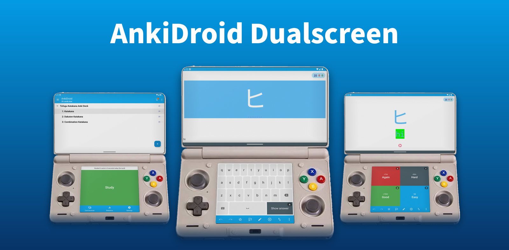
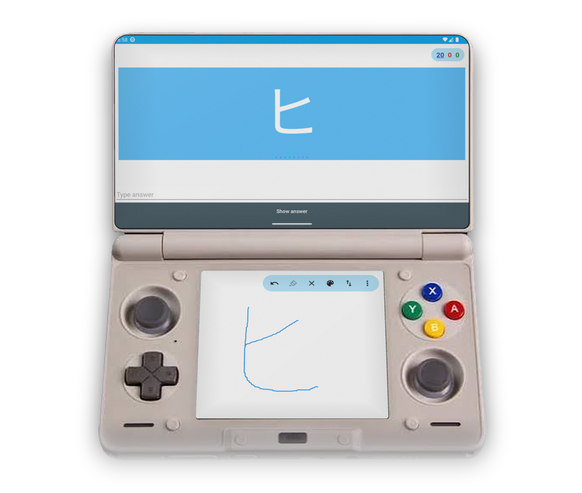
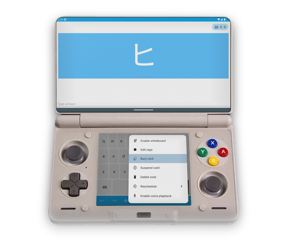
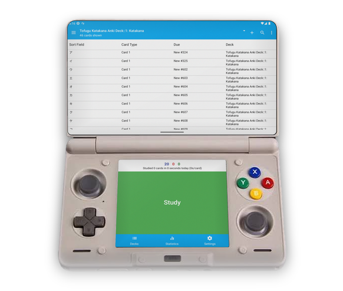

<p align="center">

</p>

<a href="https://github.com/asa07-salihg/Anki-Android-Dualscreen/releases"></a>
<a href="https://github.com/asa07-salihg/Anki-Android-Dualscreen/actions/workflows/release.yml"></a>
<a href="https://github.com/asa07-salihg/Anki-Android-Dualscreen/releases"></a>
<a href="COPYING"></a>

# AnkiDroid Dualscreen
[AnkiDroid](https://github.com/ankidroid/Anki-Android) for Android handhelds with two screens, like the [AYN Thor](https://www.ayntec.com/products/ayn-thor). The card stays on the top screen and everything you press is on the bottom one.

This is a fork, not an official AnkiDroid release. Please report problems here if you believe %100 dualscreen fork issue.

### Features

- Review controls on the bottom screen: show answer, the four answer buttons, undo, mark, flag, edit and the rest of the menu
- Swap the screens with one button if you would rather have the card at the bottom
- A keyboard on the bottom screen for cards where you type the answer. It picks the layout from the answer, the field's keyboard language and your phone's keyboards, and covers more than 45 languages including Cyrillic, Greek, Arabic, Hebrew, Korean, Japanese kana and Hindi. For scripts it cannot type, such as Chinese characters, the phone's own keyboard opens instead
- The whole bottom screen as a whiteboard
- D-pad navigation across both screens, including toolbars, lists, menus and settings
- A bottom panel on the other screens with the current deck, a Study button and shortcuts
- Optionally keep the question on top and show the answer on the bottom screen
- Nothing appears twice: if the top screen already shows something, the bottom one leaves it out
- Everything else AnkiDroid does, including AnkiWeb sync, FSRS and statistics

<p>



</p>

The options are under **Settings > Reviewing > Dual screen**.

Devices
-------
Any device whose second screen shows up in Android as a separate display should work. The layout adjusts to the size of the second screen.

- **[AYN Thor](https://www.ayntec.com/products/ayn-thor)** (3.92", 1240×1080) is what this was built on
- **[Anbernic RG DS](https://anbernic.com/products/rgds)** (4", 640×480) and **[AYANEO Pocket DS](https://www.ayaneo.com/product/AYANEO-Pocket-DS)** (5", 1024×768) were tested at their screen sizes. On the RG DS, Android treats the bottom screen as the main one, so use **Swap screens**
- **[OneXSugar Sugar 1](https://onexplayerstore.com/products/onexsugar-sugar-1-the-world-s-first-transformable-dual-screen-handheld-console)**, **[Retroid Pocket Duo](https://www.goretroid.com/products/retroid-pocket-duo-handheld)** and the **[Retroid Dual Screen Add-on](https://www.goretroid.com/products/retroid-dual-screen-add-on)** should work but have not been tried

Controls
--------
On the question, **A** shows the answer. On the answer, **A** is Good, **B** is Again, **X** is Hard and **Y** is Easy.

The **D-pad** moves a highlight across both screens as if they were one, and **A** presses whatever is highlighted. **B** closes a menu and **Back** leaves the screen.

The bindings can be changed in **Settings > Controls**, and the hints on the bottom screen follow them.

Install
-------
<a href="https://apps.obtainium.imranr.dev/redirect?r=obtainium://add/https://github.com/asa07-salihg/Anki-Android-Dualscreen">
    </a>

Or download `AnkiDroid-Dualscreen.apk` from [Releases](https://github.com/asa07-salihg/Anki-Android-Dualscreen/releases/latest). Every release has a `SHA256SUMS.txt` next to the APK so you can check the download.

It installs as **AnkiDroid Dualscreen** (`com.ichi2.anki.dualscreen`), next to AnkiDroid and with its own collection. Sync with AnkiWeb to bring your decks over.

Building
--------
With JDK 21:
```
./gradlew :AnkiDroid:assembleFullRelease
```
Everything else is the same as upstream, see the [development guide](https://github.com/ankidroid/Anki-Android/wiki/Development-Guide).

Pushing a `v*` tag builds a signed APK and publishes it as a release.

Credits
-------
- [AnkiDroid](https://github.com/ankidroid/Anki-Android) and its [contributors](https://github.com/ankidroid/Anki-Android/graphs/contributors). This is their app with a second screen added
- [Anki](https://github.com/ankitects/anki) by Ankitects, which AnkiDroid is built on
- [Cocoon](https://github.com/inssekt/CocoonFE), for showing how two screens can work as one and how a D-pad highlight should feel
- [Obtainium](https://github.com/ImranR98/Obtainium), for updates straight from GitHub releases
- [Material Design Icons](https://github.com/google/material-design-icons), for the swap and backspace icons

License
-------
This is a modified version of AnkiDroid 2.25.1. The changes were made in 2026 and are listed in the commit history.

* [GPL-3.0 License](COPYING), like AnkiDroid
* [AGPL-3.0 License](https://github.com/ankitects/anki/blob/main/LICENSE) for some part of the back-end
* [LGPL-3.0 License](api/COPYING.LESSER) for the AnkiDroid API
